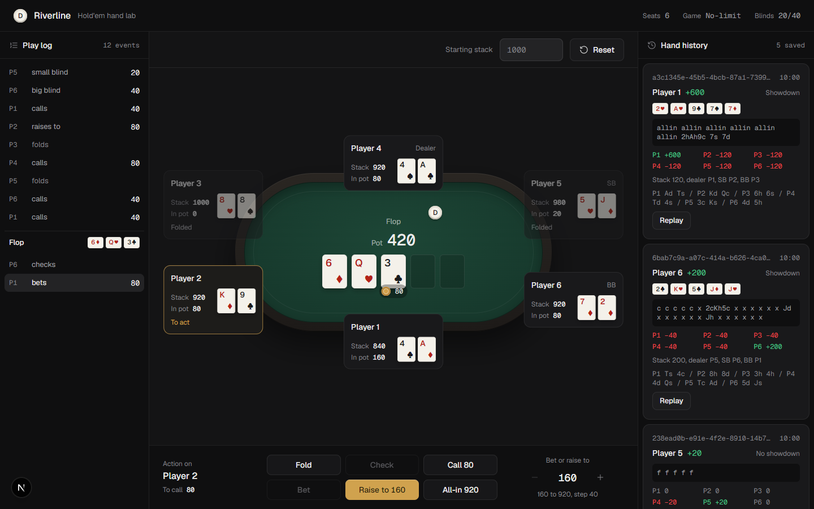
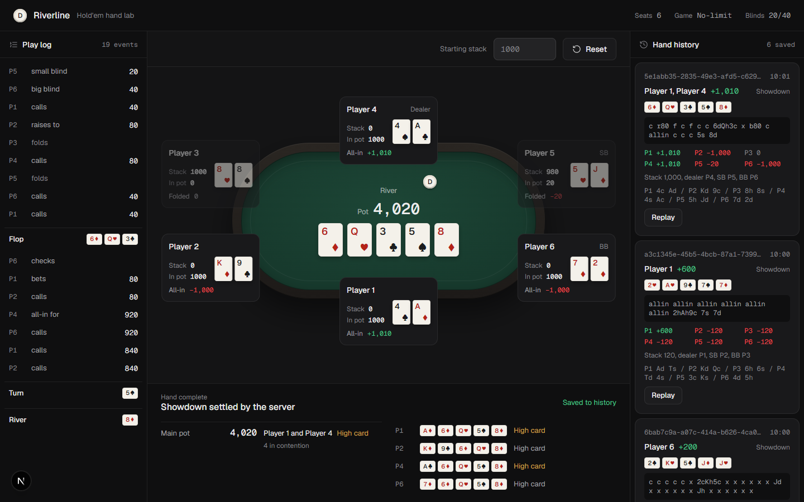
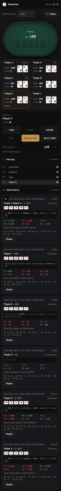
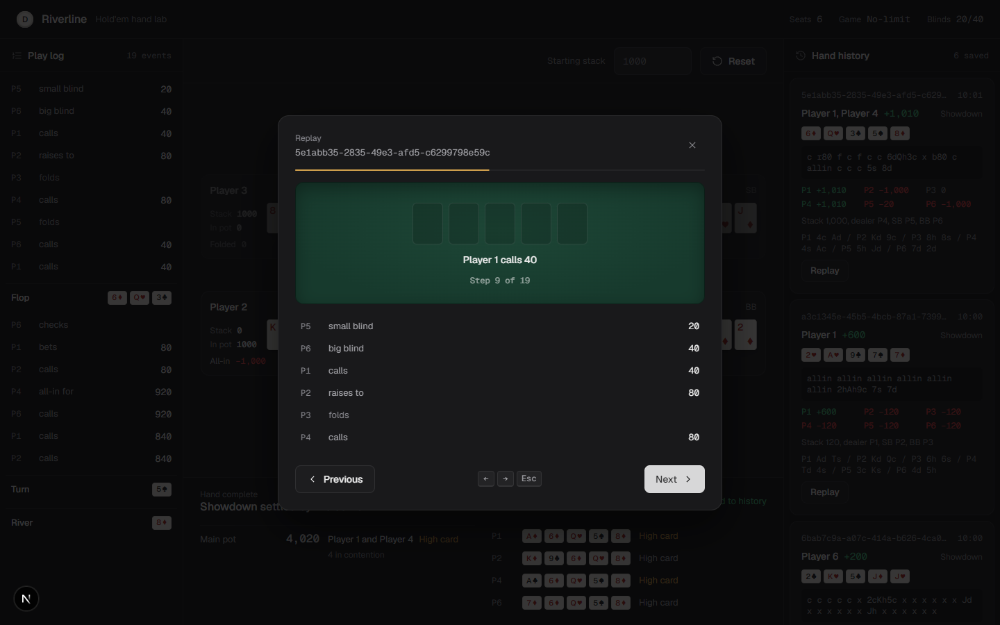
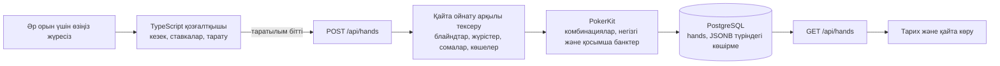

<div align="center">

# Riverline

**Алты орынға арналған лимитсіз холдемнің бір таратылымы: әр ойыншы үшін өзіңіз жүресіз, банктерді сервер есептеп, тарихта сақтайды**

[English](README.md) · [Русский](README.ru.md) · Қазақша




</div>

Riverline алты орынға лимитсіз техас холдемінің бір таратылымын береді, блайндтар 20/40. Префлоптан ашылуға дейін әр орын үшін өзіңіз жүресіз. Таратылым біткенде браузер оны API-ге жібереді. Сервер барлық әрекетті қайта ойнатып, банктерді PokerKit арқылы қайта есептейді және тек өз нәтижесін сақтайды. Таратылымдар тарихы оларды REST арқылы оқиды, кез келгенін қадамдап қайта көруге болады.

## Экранда не бар

| Бөлік | Не істейді |
|---|---|
| Үстел | Алты орны бар шұға, дилер фишкасы, әр орынның алдында осы көшенің ставка фишкалары, банк және ортақ карталар |
| Әрекет панелі | Кезегі келген ойыншыға fold, check, call, bet, raise және all-in. Рұқсат етілмеген әрекеттер өшірулі, call мен all-in түймелерінде нақты сома жазылған |
| Таратылым журналы | Барлық блайнд пен әрекет сомасымен, көшелерге бөлініп, ашылған карталармен бірге |
| Есеп | Ашылудан кейін: әр банктің сомасы, жеңімпазы және оның комбинациясы, соңына дейін жеткен әр ойыншының ең жақсы бес картасы |
| Тарих | Сақталған таратылымдар: жеңімпаз, борд, әрекеттердің қысқа жолы және әр орынның нәтижесі |
| Қайта көру | Сақталған таратылымның блайндтарын, әрекеттерін және көшелерін қадамдап көрсетеді. Бағыттауыш пернелер парақтайды, Esc жабады |

<table>
<tr>
<td></td>
<td width="28%"></td>
</tr>
<tr>
<td colspan="2"></td>
</tr>
</table>

## Бұл нұсқада не жаңа

| Не | Қазір қалай жұмыс істейді |
|---|---|
| Банктерге бөлу | Банктер тек таратылымда қалған ойыншылардың ставка деңгейлері бойынша бөлінеді. Карта тастағандардың фишкалары сол банктерге өлі ақша ретінде кіреді, сондықтан тасталған блайнд енді жеке қосымша банк болып шықпайды |
| Ең жақсы бес карта | Ашылу нәтижесі карталарды `As`, `Td` түрінде, таратылымның қалған бөлігімен бірдей жазуда сақтайды. Бұрын сақталған таратылымдар да дұрыс көрсетіледі |
| Ставка мөлшері | Bet пен raise минимумнан стекке дейінгі кез келген бүтін соманы қабылдайды, сондықтан стек 40-қа еселі болмаса да, бүкіл стекке рейз өтеді |
| Таратылым идентификаторлары | `crypto.randomUUID` болмаса, id `crypto.getRandomValues` арқылы жасалады, сондықтан үстел жергілікті желідегі мекенжайдан қарапайым HTTP арқылы ашылады |
| Сақтау | Сақтау жауабы жоғалып, сұрау қайта жіберілсе, сервердің 409 жауабы «бұрын сақталған» деп саналады да, қолданба сақталған таратылымды жүктейді |
| API қателері | 404, 409 және 503 тексеру қателерімен бірдей `{"error": {"code", "message"}}` түрінде келеді |
| Интерфейс | Шұғасы мен былғары жиегі бар үстелдің айналасындағы графит қабық, баспа карталар, әр орынның фишкалары, ашылудан кейінгі есеп парағы, пернетақтамен қайта көру және телефонға арналған беттеу |
| Ойын кезіндегі қателер | Әрекет қабылданбаса, себебі әрекет панелінің астында көрінеді |

## Таратылымның жолы



Фронтенд интерактивті күй машинасын жүргізеді: жүріс кезегі, рұқсат етілген әрекеттер, карта тарату және журнал. Шын мәнінде не болғанын сервер шешеді. Ол таратылымды әрекеттер тізімі бойынша қайта құрып, әр жүрісті, соманы және көшеге өтуді, карталарды, фишкалар балансын және әрекеттердің қысқа жолын тексереді, содан кейін ғана төлемдерді есептейді. Барлығы карта тастағаннан кейінгі жеңіс браузерде есептеліп, серверде қайта тексеріледі. Ашылудағы төлемдерді әрқашан сервер есептейді.

## Іске қосу

```bash
docker compose up -d
```

| Қызмет | Мекенжай |
|---|---|
| Қолданба | http://localhost:3000 |
| API | http://localhost:8000 |
| Swagger | http://localhost:8000/docs |

Бэкенд іске қосылғанда кестені өзі жасайды. Орта файлы, миграциялар және дерекқорды қолмен баптау қажет емес.

## API

| Әдіс | Жол | Не қайтарады |
|---|---|---|
| `GET` | `/api/hands` | Соңғы 30 таратылым |
| `GET` | `/api/hands/{id}` | Бір таратылым немесе 404 |
| `POST` | `/api/hands` | Есептелген таратылыммен 201, мұндай id бар болса 409, таратылым қате болса себебімен 422 |
| `GET` | `/health` | `{"status": "ok"}` |

## Тесттер

```bash
# бэкенд: 34 тест және ruff
cd backend
poetry install
poetry run pytest
poetry run ruff check .

# фронтенд: 29 тест, eslint, tsc және продакшен құрастыру
cd frontend
npm ci
npm run test
npm run lint
npm run typecheck
npm run build

# end-to-end, docker compose іске қосулы кезде
npx playwright install chromium
npm run test:e2e
```

GitHub Actions әр push сайын бэкенд пен фронтенд тексерулерін іске қосады.

## Техникалық шешімдер

| Шешім | Не үшін |
|---|---|
| Таза TypeScript қозғалтқышы | Покер логикасының ауысулары React-ті рендерлемей тестіленеді |
| Сервер әрекеттер тізімін қайта ойнатады | Браузерге тек өзара әрекет сеніп тапсырылады, бұрмаланған таратылым бірінші рұқсатсыз қадамда құлайды |
| PokerKit 0.7.4, нұсқасы бекітілген | Комбинациялардың күшін өзіміз жазған бағалаушы емес, қолдау көрсетілетін кітапхана есептейді |
| JSONB бар бір `hands` кестесі | Біткен таратылым өзгермейді және әрқашан толық оқылады |
| `HandRepository` ішіндегі таза SQL | Маршруттарда SQL жоқ, репозиторийде покер ережелері жоқ |

Күй машинасы, қосымша банктер және тексеру туралы толығырақ [INTERVIEW_NOTES.md](INTERVIEW_NOTES.md) файлында жазылған.

## Автор

[Koncha Artyom](https://github.com/artyom129)

Кодты пайдалану шарттары [LICENSE](LICENSE) файлында көрсетілген.
