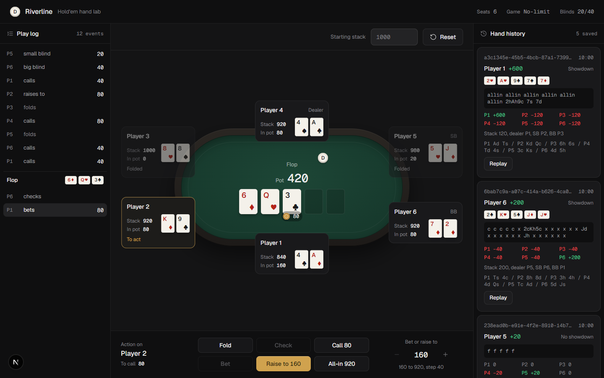
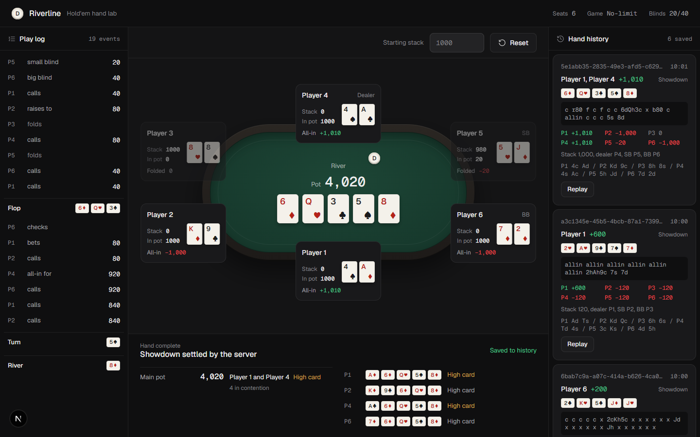
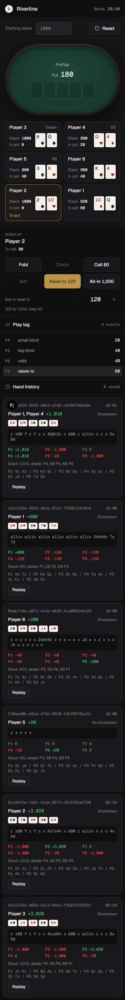
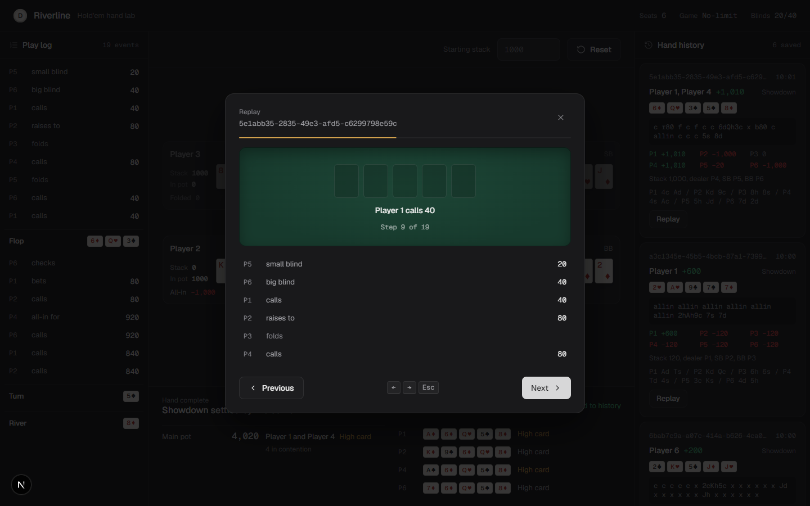
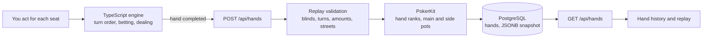

<div align="center">

# Riverline

**One six-player no-limit Hold'em hand, played seat by seat, settled by the server and kept in history**

English · [Русский](README.ru.md) · [Қазақша](README.kk.md)




</div>

Riverline deals one hand of six-max no-limit Texas Hold'em with blinds 20/40. You act for every seat from preflop to showdown. When the hand ends, the browser sends the finished snapshot to the API. The server replays every action, recalculates the pots with PokerKit and stores only the result it computed itself. Hand history reads those hands back over REST and can replay any of them step by step.

## What you see on screen

| Area | What it does |
|---|---|
| Table | Felt with six seats, the dealer button, chips in front of each seat for the current street, the pot and the board |
| Action bar | Fold, check, call, bet, raise and all-in for the seat to act. Illegal moves are disabled, and the call and all-in buttons show the exact amount |
| Play log | Every blind and action with its amount, grouped by street with the dealt cards |
| Settlement | After showdown: each pot with its amount, winner and winning hand, plus the best five cards of every player still in |
| Hand history | Saved hands with winner, board, short action string and net result per seat |
| Replay | Steps through blinds, actions and streets of a saved hand. Arrow keys move, Esc closes |

<table>
<tr>
<td></td>
<td width="28%"></td>
</tr>
<tr>
<td colspan="2"></td>
</tr>
</table>

## What's new in this version

| What | How it works now |
|---|---|
| Pot breakdown | Pots are split only at the commitment levels of players still in the hand. Chips from folded players go into those pots as dead money, so a folded blind never shows up as its own side pot |
| Best five cards | Showdown results store cards as `As`, `Td`, the same notation as the rest of the snapshot. Hands saved earlier are still shown correctly |
| Bet sizing | A bet or raise can be any whole amount between the minimum and the player's stack, so raising your whole stack works even when it is not a multiple of 40 |
| Hand ids | Ids come from `crypto.getRandomValues` when `crypto.randomUUID` is missing, so the table opens over plain HTTP on a LAN address |
| Saving | If a save is retried after its response was lost, the server's 409 counts as "already saved" and the stored hand is loaded |
| API errors | 404, 409 and 503 use the same `{"error": {"code", "message"}}` shape as validation errors |
| Interface | Graphite chrome around a felt table with a leather rail, printed cards, chips per seat, a settlement slip after showdown, keyboard replay and a phone layout |
| Errors in play | A rejected action shows its reason under the action bar |

## How a hand travels



The frontend runs the interactive state machine: turn order, legal actions, dealing and the play log. The server decides what actually happened. It rebuilds the hand from the action list, checks every turn, amount and street transition, the cards, the chip totals and the short action string, and only then settles. A fold win is computed in the browser and checked again on the server. Showdown payouts always come from the server.

## Run it

```bash
docker compose up -d
```

| Service | Address |
|---|---|
| App | http://localhost:3000 |
| API | http://localhost:8000 |
| Swagger | http://localhost:8000/docs |

The backend creates its table on startup. There is no environment file, migration step or manual database setup.

## API

| Method | Path | Returns |
|---|---|---|
| `GET` | `/api/hands` | The 30 most recent hands |
| `GET` | `/api/hands/{id}` | One hand, or 404 |
| `POST` | `/api/hands` | 201 with the settled hand, 409 if the id exists, 422 with the reason if the hand is invalid |
| `GET` | `/health` | `{"status": "ok"}` |

## Tests

```bash
# backend: 34 tests and ruff
cd backend
poetry install
poetry run pytest
poetry run ruff check .

# frontend: 29 tests, eslint, tsc and a production build
cd frontend
npm ci
npm run test
npm run lint
npm run typecheck
npm run build

# end to end, with docker compose running
npx playwright install chromium
npm run test:e2e
```

GitHub Actions runs the backend and frontend checks on every push.

## Technical decisions

| Decision | Why |
|---|---|
| Pure TypeScript engine | Poker transitions are tested without rendering React |
| Server replays the action list | The browser is trusted with interaction only, and a tampered snapshot fails at its first illegal step |
| PokerKit 0.7.4, pinned | Hand ranking comes from a maintained library instead of a home-made evaluator |
| One `hands` table with JSONB | A finished hand never changes and is always read whole |
| Raw SQL in `HandRepository` | Routes hold no SQL, and the repository holds no poker rules |

The state machine, side pots and validation are described in more detail in [INTERVIEW_NOTES.md](INTERVIEW_NOTES.md).

## Author

[Koncha Artyom](https://github.com/artyom129)

Use of the code is governed by [LICENSE](LICENSE).
