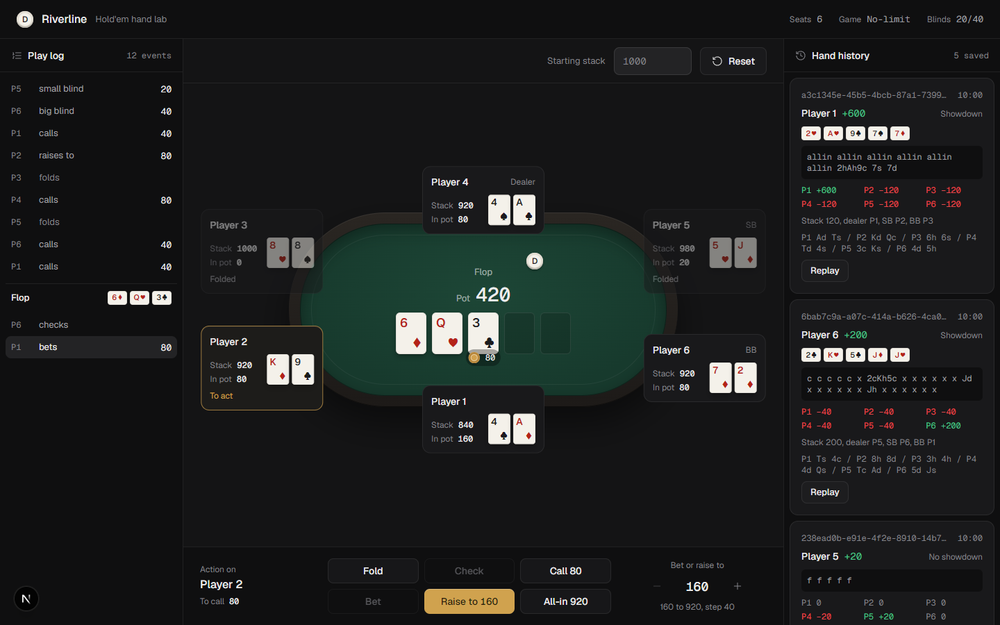
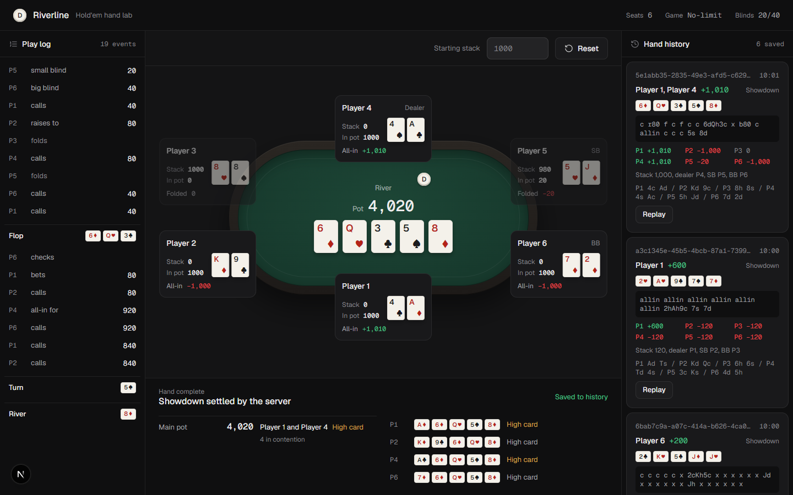
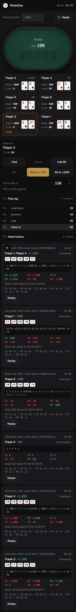
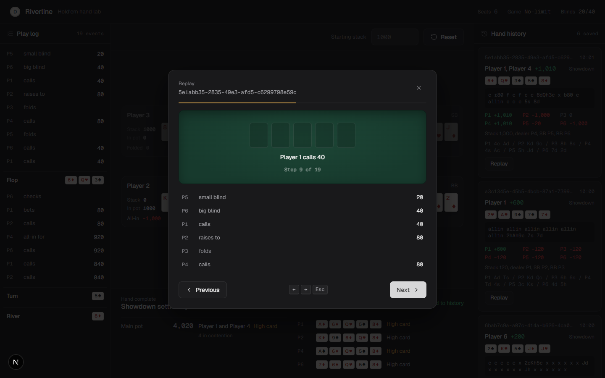
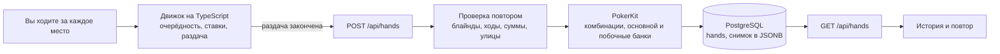

<div align="center">

# Riverline

**Одна раздача безлимитного холдема на шесть мест: вы ходите за каждого игрока, сервер рассчитывает банки и сохраняет историю**

[English](README.md) · Русский · [Қазақша](README.kk.md)




</div>

Riverline раздаёт одну руку техасского холдема без лимита на шесть мест, блайнды 20/40. Вы ходите за каждое место от префлопа до вскрытия. Когда раздача закончилась, браузер отправляет её в API. Сервер заново проигрывает все действия, пересчитывает банки через PokerKit и сохраняет только свой результат. История раздач читает их по REST, любую можно проиграть по шагам.

## Что на экране

| Область | Что делает |
|---|---|
| Стол | Сукно с шестью местами, фишка дилера, фишки ставок текущей улицы перед каждым местом, банк и общие карты |
| Панель действий | Fold, check, call, bet, raise и all-in для игрока, чей ход. Недопустимые действия выключены, на call и all-in написана точная сумма |
| Лог раздачи | Все блайнды и действия с суммами, разбитые по улицам вместе с открытыми картами |
| Расчёт | После вскрытия: каждый банк с суммой, победителем и его комбинацией, лучшие пять карт каждого, кто дошёл до конца |
| История | Сохранённые раздачи: победитель, борд, короткая строка действий и итог по каждому месту |
| Повтор | Пошаговый просмотр блайндов, действий и улиц сохранённой раздачи. Стрелки листают, Esc закрывает |

<table>
<tr>
<td></td>
<td width="28%"></td>
</tr>
<tr>
<td colspan="2"></td>
</tr>
</table>

## Что нового в этой версии

| Что | Как теперь работает |
|---|---|
| Разбивка банков | Банки делятся только по уровням ставок игроков, которые остались в раздаче. Фишки сбросивших карты входят в эти банки как мёртвые деньги, поэтому сброшенный блайнд больше не превращается в отдельный побочный банк |
| Лучшие пять карт | Результат вскрытия хранит карты как `As`, `Td`, в той же записи, что и остальная раздача. Ранее сохранённые раздачи тоже показываются верно |
| Размер ставки | Bet и raise принимают любую целую сумму от минимума до стека, так что рейз на весь стек проходит, даже если стек не кратен 40 |
| Идентификаторы раздач | Если `crypto.randomUUID` недоступен, id создаётся через `crypto.getRandomValues`, и стол открывается по обычному HTTP с адреса в локальной сети |
| Сохранение | Если ответ на сохранение потерялся и запрос ушёл повторно, 409 от сервера считается «уже сохранено», и приложение загружает сохранённую раздачу |
| Ошибки API | 404, 409 и 503 приходят в том же виде `{"error": {"code", "message"}}`, что и ошибки проверки |
| Интерфейс | Графитовая оболочка вокруг стола с сукном и кожаным бортом, печатные карты, фишки у каждого места, расчётный лист после вскрытия, повтор с клавиатуры и вёрстка для телефона |
| Ошибки во время игры | Если действие отклонено, причина видна под панелью действий |

## Путь раздачи



Фронтенд ведёт интерактивную машину состояний: очерёдность ходов, допустимые действия, раздачу карт и лог. Что произошло на самом деле, решает сервер. Он собирает раздачу заново по списку действий, проверяет каждый ход, сумму и переход улицы, карты, баланс фишек и короткую строку действий, и только потом рассчитывает выплаты. Победа после сбросов считается в браузере и ещё раз проверяется на сервере. Выплаты на вскрытии всегда считает сервер.

## Запуск

```bash
docker compose up -d
```

| Сервис | Адрес |
|---|---|
| Приложение | http://localhost:3000 |
| API | http://localhost:8000 |
| Swagger | http://localhost:8000/docs |

Бэкенд сам создаёт таблицу при старте. Файл окружения, миграции и ручная настройка базы не нужны.

## API

| Метод | Путь | Что возвращает |
|---|---|---|
| `GET` | `/api/hands` | 30 последних раздач |
| `GET` | `/api/hands/{id}` | Одну раздачу или 404 |
| `POST` | `/api/hands` | 201 с рассчитанной раздачей, 409 если такой id уже есть, 422 с причиной, если раздача некорректна |
| `GET` | `/health` | `{"status": "ok"}` |

## Тесты

```bash
# бэкенд: 34 теста и ruff
cd backend
poetry install
poetry run pytest
poetry run ruff check .

# фронтенд: 29 тестов, eslint, tsc и продакшен-сборка
cd frontend
npm ci
npm run test
npm run lint
npm run typecheck
npm run build

# end-to-end при запущенном docker compose
npx playwright install chromium
npm run test:e2e
```

GitHub Actions прогоняет проверки бэкенда и фронтенда на каждый push.

## Технические решения

| Решение | Зачем |
|---|---|
| Чистый движок на TypeScript | Переходы покерной логики тестируются без рендера React |
| Сервер проигрывает список действий | Браузеру доверено только взаимодействие, подделанная раздача падает на первом недопустимом шаге |
| PokerKit 0.7.4 с фиксированной версией | Силу комбинаций считает поддерживаемая библиотека, а не самописный оценщик |
| Одна таблица `hands` с JSONB | Законченная раздача не меняется и всегда читается целиком |
| Чистый SQL в `HandRepository` | В маршрутах нет SQL, в репозитории нет правил покера |

Подробнее про машину состояний, побочные банки и проверку написано в [INTERVIEW_NOTES.md](INTERVIEW_NOTES.md).

## Автор

[Koncha Artyom](https://github.com/artyom129)

Условия использования кода описаны в [LICENSE](LICENSE).
